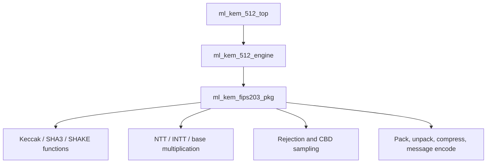

# ML-KEM-512 RTL guide for beginners

## 1. What this design implements

ML-KEM is a lattice-based **key encapsulation mechanism**. It allows two parties to establish the same 32-byte shared secret without sending the secret itself.

This project implements **ML-KEM-512**, the smallest FIPS 203 parameter set:

| Item | Value |
|---|---:|
| Polynomial count `k` | 2 |
| Polynomial degree `n` | 256 |
| Modulus `q` | 3329 |
| Public/encapsulation key `EK` | 800 bytes |
| Secret/decapsulation key `DK` | 1632 bytes |
| Ciphertext `C` | 768 bytes |
| Message `m` | 32 bytes |
| Shared secret `K` | 32 bytes |
| CBD keygen/`eta1` | 3 |
| CBD encapsulation error/`eta2` | 2 |

The RTL is behaviorally checked against NIST ACVP vectors. It is not yet a practical fully pipelined/iterative FPGA implementation; the package functions are still large combinational expansions.

---

## 2. Mathematical objects

### 2.1 Polynomial ring

Each ML-KEM polynomial has 256 coefficients:

$$
a(x)=a_0+a_1x+\cdots+a_{255}x^{255}
$$

Coefficients are reduced modulo

$$q=3329.
$$

Multiplication is in the negacyclic ring

$$R_q=\mathbb Z_q[x]/(x^{256}+1).
$$

The relation $x^{256}=-1$ means that terms wrapping from the high end change sign.

For direct coefficient multiplication, coefficient $k$ is:

$$
c_k=\sum_{j=0}^{k}a_j b_{k-j}
-
\sum_{j=k+1}^{255}a_j b_{256+k-j}\pmod q.
$$

The first sum contains terms that do not wrap. The second sum contains terms that wrap and therefore receive a minus sign.

### 2.2 NTT

Direct polynomial multiplication requires about $256^2$ coefficient products. The Number Theoretic Transform (NTT) allows much faster multiplication:

$$
c=\operatorname{INTT}(\operatorname{NTT}(a)\odot\operatorname{NTT}(b)).
$$

Here $\odot$ is pointwise multiplication, but ML-KEM's negacyclic NTT actually uses small quadratic base factors. `basemul` implements these factors.

A forward butterfly is conceptually:

$$
t=\zeta b \pmod q
$$

$$
b'=a-t\pmod q,\qquad a'=a+t\pmod q.
$$

The inverse transform reverses the stage order and applies

$$128^{-1}\bmod 3329 = 3303.$$

### 2.3 Centered binomial distribution (CBD)

Small secret and error coefficients come from CBD sampling. If $a$ and $b$ are the sums of $\eta$ random bits,

$$
\operatorname{CBD}_\eta = a-b.
$$

For ML-KEM-512, `eta=3` is used for secret/encryption randomness and key-generation noise. `eta=2` is used for the relevant encapsulation error terms.

### 2.4 Compression and decompression

A coefficient is compressed to $d$ bits using:

$$
\operatorname{Compress}_d(x)=
\left\lfloor\frac{(x\ll d)+q/2}{q}\right\rfloor
\bmod 2^d.
$$

Decompression estimates the original coefficient:

$$
\operatorname{Decompress}_d(y)=
\left\lfloor\frac{yq+2^{d-1}}{2^d}\right\rfloor.
$$

ML-KEM-512 ciphertext uses $d=10$ for the two `u` polynomials and $d=4$ for `v`.

### 2.5 Message encoding

A message bit 0 becomes coefficient 0. A bit 1 becomes approximately $q/2$:

$$
0\rightarrow0,\qquad 1\rightarrow \left\lceil q/2\right\rceil=1665.
$$

Decoding tests whether a coefficient lies in the middle half of the modulus.

---

## 3. Production RTL hierarchy



Only the files `rtl/ml_kem/ml_kem_512_top.sv`, `rtl/ml_kem/ml_kem_512_engine.sv`, and `rtl/common/ml_kem_fips203_pkg.sv` form the current production hierarchy.

Other standalone RTL under `rtl/keccak`, `rtl/sha3`, `rtl/ntt`, and `rtl/poly` is retained for independent unit testing. The production engine uses the package functions, not those standalone modules.

---

## 4. File-by-file RTL explanation

## 4.1 `rtl/ml_kem/ml_kem_512_top.sv`

This is the FPGA-facing module.

It declares:

- clock and active-low asynchronous reset
- `start` request
- `cmd[1:0]`
- deterministic key-generation seeds `seed_d` and `seed_z`
- 32-byte `msg_in`
- 800-byte `pk_in`
- 1632-byte `sk_in`
- 768-byte `ct_in`
- full-width outputs
- `busy`, `valid`, and `status`

The module does not contain cryptographic math. It only connects these ports to `ml_kem_512_engine`. This separation gives future interfaces, such as an AXI wrapper, one stable place to connect.

## 4.2 `rtl/ml_kem/ml_kem_512_engine.sv`

This module is the ML-KEM controller and algorithm coordinator.

### Input capture

When `start` is accepted in `IDLE`, the engine copies all relevant input ports into `*_r` registers. Later input changes do not affect the active operation.

### Control states

1. `IDLE` — no operation active.
2. `ACQUIRE` — validate EK or DK shape.
3. `RUN_HASH` — reserved hash phase.
4. `RUN_POLY` — reserved polynomial phase.
5. `COMPUTE` — executes package functions containing the ML-KEM algorithm.
6. `DONE` — clears `busy`, pulses `valid` for one cycle, returns to idle.

`RUN_HASH` and `RUN_POLY` are presently placeholder control phases. The actual expensive hash and polynomial work occurs in `COMPUTE`, which is why synthesis currently expands an enormous combinational graph.

### `matrix_poly`

This forms

$$
\operatorname{SampleNTT}(\operatorname{SHAKE128}(\rho\,\|\,j\,\|\,i)).
$$

It returns one polynomial of matrix $A$ directly in NTT form.

### `noise`

This forms

$$
\operatorname{CBD}_\eta(\operatorname{SHAKE256}(seed\,\|\,nonce)).
$$

The nonce distinguishes secret, error, and encryption polynomial streams.

### `keypair_ek`

1. Split $G(d\|2)$ into $\rho$ and $\sigma$ using SHA3-512.
2. Expand the $2\times2$ public matrix $A$ from $\rho$.
3. Sample $s_0,s_1$ and $e_0,e_1$.
4. Transform $s$ and $e$ into NTT form.
5. Compute
   $$t=A s+e.$$
6. Serialize $t_0,t_1$ using 12-bit encoding and append $\rho$.

The result is the 800-byte encapsulation key $EK$.

### `keypair_dk`

The decapsulation key is assembled as:

$$
DK=\operatorname{Encode}_{12}(\widehat{s})\|EK\|H(EK)\|z.
$$

This exactly explains the 1632-byte width:

$$768\text{ bytes of }\widehat{s}+800\text{ bytes of }EK+32+32=1632.$$

### `encrypt_pke`

1. Extract $\rho$ and $t$ from EK.
2. Expand $A$.
3. Sample $r,e_1,e_2$.
4. Transform $r$ to NTT form.
5. Compute:
   $$u=A^T r+e_1,$$
   $$v=t^T r+e_2+\operatorname{Encode}(m).$$
6. Compress $u$ to 10 bits and $v$ to 4 bits.
7. Pack the two 320-byte $u$ values and the 128-byte $v$ value into 768 bytes.

### `decrypt_pke`

1. Unpack and decompress $u$ and $v$.
2. Compute the secret inner product $s^T u$.
3. Recover the message polynomial:
   $$v-s^T u.$$
4. Decode it into 32 message bytes.

### KEM commands

- `op=00`: return EK and DK.
- `op=01`: compute $H(EK)$, derive $(\bar K,coins)=G(m\|H(EK))$, run PKE encryption, return ciphertext and $\bar K$.
- `op=10`: decrypt candidate message, re-encrypt it, and compare every ciphertext byte. A match returns $\bar K$; a mismatch returns
  $$J(z\|c)=\operatorname{SHAKE256}(z\|c).$$

The full re-encryption and implicit rejection are the Fujisaki-Okamoto-style validation required by ML-KEM decapsulation.

## 4.3 `rtl/common/ml_kem_fips203_pkg.sv`

This package contains the low-level algorithms shared by the engine. Production functions are currently package functions rather than separate hardware modules.

### Reduction

- `reduce_q` uses multiplication and shifts to estimate division by 3329 and then corrects the remainder.
- `modq` applies that reduction.

### Hash/XOF

- `keccak` performs 24 rounds of Keccak-f[1600].
- `absorb` absorbs rate-sized blocks and applies FIPS 202 padding.
- `squeeze` returns XOF bytes.
- `sha3_256` uses rate 136 and suffix `0x06`.
- `sha3_512` uses rate 72 and suffix `0x06`.
- `shake128` uses rate 168 and suffix `0x1F`.
- `shake256` uses rate 136 and suffix `0x1F`.

### Polynomial arithmetic

- `zeta` generates twiddle factors using bit reversal.
- `ntt` performs forward transform stages.
- `intt` reverses the stages and scales by 3303.
- `basemul` multiplies the ML-KEM quadratic NTT factors.
- `addp` and `subp` operate coefficient by coefficient modulo 3329.

### Sampling

- `sample_ntt` reads two 12-bit candidates per three bytes and rejects values at or above 3329.
- `cbd` converts small SHAKE bit streams into centered coefficients.

### Serialization

- `pack12` / `unpack12`: 256 coefficients, 12 bits each, 384 bytes.
- `pack10` / `unpack10`: 320 bytes.
- `pack4` / `unpack4`: 128 bytes.
- `encode_msg` / `decode_msg`: 256 message bits.

### Validation

- `ek_valid` checks both polynomial halves for canonical coefficients below 3329.
- `dk_valid` extracts EK, recomputes $H(EK)$, and checks the embedded hash.

## 4.4 Standalone primitive RTL

These modules do not participate in the current production top hierarchy. They are retained as simple, inspectable units and have functional benches.

- `rtl/keccak/keccak_f1600.sv`: standalone 1600-bit permutation.
- `rtl/sha3/sha3_256.sv`: standalone single-buffer SHA3-256 implementation.
- `rtl/sha3/sha3_512.sv`: standalone SHA3-512 implementation.
- `rtl/sha3/shake128.sv`: standalone 256-bit-output-limited SHAKE128 wrapper.
- `rtl/sha3/shake256.sv`: standalone 256-bit-output-limited SHAKE256 wrapper.
- `rtl/ntt/ntt_256.sv`: signed standalone NTT arithmetic.
- `rtl/ntt/intt_256.sv`: signed standalone inverse NTT arithmetic.
- `rtl/poly/poly_arith.sv`: coefficient-wise sum/sub/product unit.
- `rtl/poly/poly_core.sv`: coefficient-wise sum/difference unit.

They are useful for learning and unit regression, but the complete ML-KEM paths are implemented in the FIPS 203 package and engine.

---

## 5. Port and byte-order conventions

See `ARCHITECTURE.md` for the complete port table and command/status definitions.

SystemVerilog buses are displayed MSB-first, matching normal hexadecimal ACVP strings. The sponge input code reverses indexed bus bytes into serial stream order. A user integrating the core must preserve this documented convention or convert data at the boundary.

---

## 6. Rebuilding the implementation

To recreate this design from scratch:

1. Implement Keccak-f[1600] and test it against a known permutation.
2. Implement multi-block SHA3/SHAKE sponge handling.
3. Implement modular arithmetic modulo 3329.
4. Implement NTT, inverse NTT, and base multiplication; verify random round trips.
5. Implement rejection sampling and CBD sampling.
6. Implement 12-, 10-, 4-, and 1-bit serialization.
7. Implement PKE key generation, encryption, and decryption.
8. Wrap PKE with KEM key generation, encapsulation, decapsulation, and implicit rejection.
9. Compare every output with NIST ACVP.
10. Refactor combinational package operations into iterative FPGA units before claiming timing closure.

The current files provide a complete algorithmic reference, but the final iterative hardware architecture remains a separate implementation task.

---

## 4A. Algorithm-to-source navigation

Use this table while reading the RTL. Names are the exact functions/state locations in the current source; use VS Code symbol search to jump to each one.

| Read this algorithm step | Open this RTL symbol | What to observe |
|---|---|---|
| Reduce a coefficient modulo 3329 | `reduce_q`, `modq` in `ml_kem_fips203_pkg.sv` | magnitude, Barrett quotient estimate, correction |
| Keccak-f round | `keccak` in `ml_kem_fips203_pkg.sv` | $\theta$, $\rho/\pi$, $\chi$, and round-constant $\iota$ |
| Absorb byte streams | `absorb` | XOR into rate, permute on full rate, apply suffix and final bit |
| Expand $\rho$ to matrix | `matrix_poly` | constructs `rho || j || i`; calls SHAKE128 and rejection sampling |
| Sample secret/error | `noise` and `cbd` | constructs `seed || nonce`; sums/subtracts bit groups |
| NTT transform | `ntt` | 256 coefficients, butterfly stages, twiddle index progression |
| NTT multiplication | `basemul` | 64 four-coefficient quadratic blocks with $+z$ and $-z$ factors |
| Return from NTT domain | `intt` | reverse butterfly stages and final scale 3303 |
| PKE key generation | `keypair_ek` | $A s+e$, producing 800-byte EK |
| DK assembly | `keypair_dk` | secret encoding, EK, H(EK), z |
| PKE encryption | `encrypt_pke` | $u=A^Tr+e_1$, $v=t^Tr+e_2+m$; compression |
| PKE decryption | `decrypt_pke` | $v-s^Tu$ and message-bit decode |
| KEM key generation command | engine `COMPUTE`, `op_r==00` | calls keypair functions |
| KEM encapsulation command | engine `COMPUTE`, `op_r==01` | derives G output; returns C and Kbar |
| KEM decapsulation command | engine `COMPUTE`, else branch | decrypt, re-encrypt, compare, Kbar/J selection |
| Accept/reject request | engine `IDLE`, `ACQUIRE` | request latching, key validation, status |
| Completion handshake | engine `DONE` | `busy=0`, one-cycle `valid=1` |

## 4B. How to read one complete operation

### Key generation trace

```mermaid
flowchart LR
  D[d seed] --> G[SHA3-512 d || 02]
  G --> R[rho]
  G --> S[sigma]
  R --> M[SHAKE128 matrix A]
  S --> CBD[SHAKE256 and CBD]
  CBD --> SH[secret s and error e]
  M --> MUL[NTT base multiplication]
  SH --> MUL
  MUL --> T[t = A*s + e]
  T --> EK[800-byte EK]
  EK --> H[SHA3-256 H(EK)]
  EK --> DK[1632-byte DK]
  H --> DK
```

In source order, start at `keypair_ek`, then inspect every called helper in `ml_kem_fips203_pkg.sv`. After EK is computed, `keypair_dk` rebuilds the transformed secret from the same deterministic seed and assembles DK. Recomputing the secret avoids retaining extra intermediate state in this behavioral reference architecture.

### Encapsulation trace

```mermaid
flowchart LR
  EK --> EH[SHA3-256 H(EK)]
  M[message m] --> G[SHA3-512 m || H(EK)]
  EH --> G
  G --> K[Kbar]
  G --> COINS[coins]
  COINS --> RNG[SHAKE256 + CBD]
  EK --> A[extract rho and t; expand A]
  A --> EN[u and v equations]
  RNG --> EN
  M --> EN
  EN --> C[compress and pack C]
```

The output shared secret is the first 32 bytes of SHA3-512's 64-byte result. The remaining 32 bytes are deterministic PKE encryption coins.

### Decapsulation trace

```mermaid
flowchart LR
  C[ciphertext] --> UN[unpack and decompress]
  DK --> SEC[extract secret and embedded EK]
  UN --> DEC[v - s*u]
  SEC --> DEC
  DEC --> MP[recover message m']
  MP --> RE[derive new coins and re-encrypt]
  SEC --> RE
  RE --> CMP[compare all C' and C bytes]
  CMP -->|match| GOOD[Kbar]
  CMP -->|mismatch| BAD[SHAKE256 z || C]
```

The full-byte compare is intentionally after re-encryption. The caller does not receive the decrypted message; it receives a 32-byte shared-secret value.

## 4C. Small worked data-size example

A 384-byte polynomial encoding contains exactly 256 12-bit values:

$$384\times8=3072=256\times12.$$

Therefore EK has two encoded public polynomials plus 32 bytes of $\rho$:

$$384+384+32=800.$$

Ciphertext similarly contains two 10-bit polynomial fields and one 4-bit field:

$$\frac{256\times10}{8}+\frac{256\times10}{8}+\frac{256\times4}{8}
=320+320+128=768.$$

DK combines the two 12-bit secret polynomials, EK, H(EK), and z:

$$384+384+800+32+32=1632.$$

These arithmetic checks are useful when locating bus-width or packing bugs.
